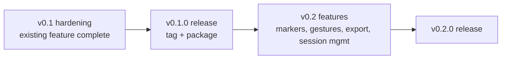

# myopyc milestones

Roadmap toward **v0.1.0** (alpha hardening and release of what already exists) and
**v0.2.0** (collection-workflow features), tracked simultaneously.

Legend: `[x]` done · `[ ]` pending · `~[ ]~` not started / deferred
Definition of done for each task: code merged, tests where applicable, CHANGELOG updated.

---

## v0.1.0 — Alpha hardening & release

Goal: ship the current feature set (live EMG/IMU GUI, up to two Myos, RAM-first
chunked recorder, reader API, headless CLI) as a tested, documented, tagged
alpha. The bulk of the feature work is landed; remaining items are validation,
packaging and polish.

### Release gate decision (Q1, revised)

**v0.1.0 tags once the software-side checklist is complete AND the 30-minute dual-Myo hardware soak passes with zero unaccounted drops.** Disconnect/reconnect UX is NOT a tag blocker; it is scheduled as a **0.1.x patch blocker** in the section after the release section.

### Core capture & devices

- [x] `SampleBatch` / `DeviceInfo` stream model with structured EMG/IMU dtypes (`devices/model.py`, `streams/schema.py`)
- [x] Simulated armband source at real sample rates (EMG 200 Hz, IMU 50 Hz) (`devices/simulator.py`)
- [x] `dl-myo` BLE adapter on a private asyncio thread; Qt loop never blocks on Bluetooth (`devices/adapter.py`)
- [x] `DeviceManager` with up-to-two-device limit, subscribe/start/stop API (`devices/manager.py`)
- [x] MAC-to-label bindings persisted in `~/.config/myopyc/config.toml` (`config.py`)
- [x] Battery level shown per device (adapter already has `BatteryFn` hook; wire it into `MainWindow`)

### Live UI

- [x] `MainWindow` with toolbar (Record, Add simulated arm, Connect Myo, Restart streams) (`ui/main_window.py`)
- [x] Per-device `DeviceView`: 8-channel EMG oscilloscope + IMU traces, 40 ms refresh (`ui/plots.py`)
- [x] `LiveBuffer` ring per device/stream, thread-safe (`streams/live.py`)
- [x] App theme module (`ui/theme.py`)
- [x] Configurable scroll windows honored from `config.ui` (`emg_window_s` / `imu_window_s`) — verify wiring end-to-end
- [x] Status bar: stream health, sample rates, dropped-sample counter
- [ ] Demo GIF/screenshots in README (`scripts/record_demo.sh` exists; capture output)

### Recorder & data format

- [x] RAM-first buffering with time-based flush to chunked `.npy` files (`recorder/writer.py`)
- [x] JSON manifest: schema version, devices, chunk index, sample counts, drops, gaps (`recorder/manifest.py`)
- [x] Overflow policy: drop oldest, record gap, never stall the BLE stream
- [x] `SessionReader` / `load_session` reader API returning typed NumPy arrays (`recorder/reader.py`)
- [x] Format round-trip tests incl. multi-flush ordering and overflow gaps (`tests/test_recorder.py`, `tests/test_schema.py`)
- [x] Crash-safety decision: **lightweight session repair in v0.1 scope** — on session open, reconcile orphaned/mid-write chunk files against the manifest (quarantine or drop chunks not listed, patch counts), then atomic manifest rewrite. Pre-tag blocker.
- [x] Implement `repair_session()` in `recorder/reader.py` (or a new `recorder/repair.py`): detect unlisted `.npy` files and truncated last chunks; expose via `inspect` and GUI open path
- [x] Tests: simulated SIGKILL mid-flush leaves recoverable state; repair is idempotent; data through last completed flush preserved exactly
- [x] Format versioning decision: **append-only optional fields; `FORMAT_VERSION` stays 1** — readers must ignore unknown keys, writers must only add new optional top-level/per-stream fields. Old readers never break.
- [x] Encode the append-only rule explicitly: `manifest.py` validation ignores unknown fields; document the contract in the data-format spec

### CLI & headless

- [x] `gui`, `record`, `inspect`, `sessions` subcommands with `--simulate/--ble/--output-dir/--flush-interval` (`cli.py`)
- [x] Default invocation starts GUI with one simulated armband
- [x] `myopyc record --max-seconds` guard and exit codes documented (`docs/usage.md`)
- [x] `inspect --json` machine-readable output for scripting

### Tests, CI & quality

- [x] pytest suite covering config, devices, schema, recorder, live buffer (22 tests)
- [x] CI workflow (`.github/workflows/ci.yml`)
- [x] pre-commit + ruff + mypy configured (`pyproject.toml`, `.pre-commit-config.yaml`)
- [x] Coverage floor agreed and enforced (e.g. `--cov-fail-under`) for `src/myopyc` (initial floor 70% via coverage config + CI)
- [x] mypy pass on `tests/` too, or explicit exclusion rationale
- [x] CI matrix: confirm Linux-only stance in CI comments; headless Qt (`QT_QPA_PLATFORM=offscreen`) for UI smoke tests (done 2026-11-20: Linux-only stance documented as a comment in `ci.yml`, `QT_QPA_PLATFORM=offscreen` set explicitly in the CI Test step; the offscreen UI smoke tests themselves already live in `tests/test_ui_status_health.py`)

### Docs & release

- [x] README: install, run, recorded-data layout, config reference, dev commands
- [x] `docs/setup-linux.md` (BlueZ/prives) and `docs/usage.md`
- [x] CHANGELOG 0.1.0 entry drafted; GPL-3.0 licensing consistent with `dl-myo`
- [x] Final docs pass: data-format spec section (chunk dtypes, `t_ns` semantics, gap encoding)
- [x] Version single-source check (`myopyc.__version__` ↔ `pyproject.toml` ↔ CHANGELOG)
- [ ] Hardware soak (above) passed — explicit precondition for tagging
- [x] Distribution decision (Q6): **GitHub releases only for v0.1** — install from git via `uv`/`pip`; PyPI publication revisited at v0.2
- [x] Tag `v0.1.0`, build wheel + sdist, attach both to the GitHub release with release notes (done 2026-11-20; soak-pending caveat stated in the release notes per user decision)
- [x] Post-release: bump to `0.2.0.dev0` (done 2026-11-20: `__init__.py`, `pyproject.toml`, and the CHANGELOG `## [0.2.0.dev0]` heading kept in lockstep, guarded by the version single-source test)

### Hardware validation (pre-tag blocker)

- [ ] Hardware soak test: 30 min continuous dual-Myo capture, zero unaccounted drops — **MUST pass before `v0.1.0` tag**

### 0.1.x patch blockers (post-tag)

- [x] BLE disconnect/reconnect behavior documented and surfaced as device status in the UI — gates 0.1.1+ (done 2026-11-20: `reconnecting` device state typed and colored in the device panel, status-bar health line tags non-streaming devices with a `⚠` warning marker, policy documented in `docs/setup-linux.md`)

---

## v0.2.0 — Collection workflow

Goal: turn myopyc from a capture utility into a lab-ready collection tool:
annotations, gesture/pose events, session management, and export for downstream
analysis. All tasks below are pending; none of this exists in the codebase yet.

**Scope decision (Q5): v0.2.0 ships in full** — markers, EVENT stream, session
management, playback, export, calibration, and robustness all release together.
No trimming to 0.2.1/0.3.

### Event markers & annotations

- [x] Marker model: timestamped, label + free-text note, session-scoped (done 2026-11-22: `Marker` dataclass in `recorder/markers.py`, host-monotonic `t_ns` shared with the stream timebase)
- [x] Marker injection from GUI (keyboard shortcuts, e.g. `M` + number row) and headless (`record --marker-file`) — headless done 2026-11-22 (`record --marker-file <jsonl>` with `label` + exactly one of `offset_s`/`t_ns`, optional `note`); GUI keyboard injection done 2026-11-22 (`M 1`–`M 9` chorded shortcuts inject a marker into the open recording on the shared host-monotonic timebase, status-bar confirmation, no-op with a hint when not recording; offscreen Qt tests cover injection round trip into the manifest and the no-recording guard)
- [x] Markers persisted to manifest as a new optional `markers` array (purely additive under the append-only rule; `FORMAT_VERSION` remains 1) (done 2026-11-22: documented in `docs/data-format.md#markers`, tolerant reader skips malformed entries)
- [x] Marker lanes/overlay rendered on live plots and in `inspect` summary — `inspect` summary includes `markers` (done 2026-11-22); live-plot marker lanes/overlay rendered on EMG/IMU plots in both live recording and read-only playback (done 2026-11-22, vertical dashed marker lines labeled on the shared host-monotonic `t_ns` axis; offscreen Qt tests in `tests/test_marker_overlay.py`)
- [x] Tests: marker round-trip writer → manifest → reader (done 2026-11-22: `tests/test_markers.py` — round trip, post-stop injection, summary inclusion, malformed-entry tolerance, JSONL parser, CLI injection/exit codes, append-only guard)

### Gesture & pose events

**Decision (Q4): option A — a dedicated third stream kind.** Gesture/pose events are a first-class recorded stream with their own dtype and chunk directory, sharing the EMG/IMU timebase conventions. They are NOT modeled as manifest-only markers.

- [x] `StreamKind.EVENT` added to `streams/schema.py` with a dedicated dtype: `t_ns` (int64), `seq` (int64), `type` (uint8 — none/fist/wave_left/wave_right/double_click), `payload` (packed `ox/oy/oz/ow` orientation quaternion), plus `stream_meta()` entry documenting the event vocabulary (event-driven, `sample_rate_hz` 0.0)
- [x] Capture `dl-myo` gesture/orientation events (`DlMyoSource` hooks) as a third stream kind (`StreamKind.EVENT`) (done 2026-11-20: `ClassifierMode.ENABLED`, pose classifier events decoded into EVENT batches with last-IMU orientation payload; non-pose/unmapped events dropped)
- [ ] Event dtype: host timestamp, sequence, type, payload
- [x] `DlMyoSource` gains an event sequence counter (`_event_seq`) mirroring the EMG/IMU counters, so event ordering survives reconnection (done 2026-11-20: counter present in `adapter.py`, incremented only on mapped poses so ordering never skips; covered by `tests/test_devices.py`)
- [x] Event stream recorded as an additional per-device stream entry in the manifest (append-only; `FORMAT_VERSION` stays 1) plus its own `event/` chunk directory — verify old v0.1 readers tolerate an unknown stream key and simply skip it (done 2026-11-20: `test_legacy_v01_reader_skips_event_stream` pins the EMG/IMU-only reader skip path)
- [x] `SimulatedSource` emits plausible gesture events at a low random rate so the event stream is demoable and testable without hardware
- [x] Round-trip tests: write + read EVENT chunks, manifest lists all three streams, reader returns the structured array
- [x] Recorder emits `event/` chunk directories per device and the manifest lists `event` alongside `emg`/`imu` (append-only; old readers skip it)
- [x] GUI flash/annotation when a gesture fires; toggleable suppression (done 2026-11-20: `DeviceView.announce_event()` flashes a bold amber `gesture: <name>` label for 2 s then dims; checkable "Gesture annotations" toolbar action persisted as `ui.gesture_annotations` in `config.toml`; offscreen Qt tests cover flash, toggle and config round trip)
- [x] Recorded and readable via `SessionReader` like EMG/IMU (done 2026-11-22: `SessionReader.load/load_stream/iter_chunks/chunks/summary` and `SessionData`/`DeviceData` indexing cover `StreamKind.EVENT` like EMG/IMU; explicit parity test `tests/test_recorder.py::test_event_stream_readable_via_session_reader_like_emg_imu`)

### Session management (GUI)

- [x] Sessions dock: list, open, rename, delete (wraps `find_sessions`) (done 2026-11-22: `SessionsDock` in `ui/sessions_dock.py` with manifest-derived summaries, open routes into playback, rename with validation/collision guards, delete with confirmation, active-recording protection, toolbar "Sessions" dock toggle, auto-refresh on recording stop; offscreen Qt tests in `tests/test_sessions_dock.py`)
- [x] Read-only playback of a recorded session through the same plot widgets (done 2026-11-22: `PlaybackBar` + `PlaybackController` in `ui/playback.py` — dock "Open"/double-click mounts read-only `DeviceView`s per recorded device driven from the host-monotonic `t_ns` timeline with a scrub slider and 2x play/pause/stop; private `LiveBuffer`, strictly read-only session access; mutual exclusion with recording; offscreen Qt tests in `tests/test_playback.py`)
- [x] Per-session notes field (edit manifest note or sidecar `notes.md`) (done 2026-11-22: manifest-canonical top-level `notes` string, append-only `FORMAT_VERSION==1`; Sessions dock Notes… dialog with atomic rewrite and active-recording protection; `SessionReader.summary()` / `SessionData.notes` / `inspect --json` expose `notes`; docs + tests)
- [x] Export session directory to zip with manifest integrity check (done 2026-11-22: `myopyc export <session> --format zip` archives the whole session directory plus a generated `INTEGRITY.json` SHA-256 sidecar; `verify_session_zip()` reports missing/corrupted/unexpected members; self-verified at write time; tests + `docs/usage.md` + CHANGELOG)

### Export & interop

- [x] `myopyc export <session> --format csv|npz` for one-off analysis (CLI subcommand; default output `<session>-export`; CSV one file per device/stream, NPZ one compressed archive with `<device>/<stream>` keys)
- [x] CSV export with human-readable ISO timestamps alongside `t_ns` (`t_iso` column rendered from the host monotonic clock — relative time, not wall-clock)
- [x] Document a NumPy → lab software (e.g. EEGLAB/LabChart) interchange recipe in `docs/` (done 2026-11-22: `docs/interop-lab-software.md` covers `load_session`/dtype-aware reshaping, `t_ns`/units/gap caveats, CSV/MAT recipes, and EEGLAB/LabChart-oriented import sketches; linked from `README.md` and `docs/usage.md`)

### Signal quality & calibration

- [ ] Raw-signal quality view: per-channel histogram / saturation detection during a calibration routine
- [ ] Guided calibration workflow (relax / flex sequence with prompts) writing a `calibration` block into the manifest
- [x] Simple derived channels toggle: rectified, RMS envelope, per-channel notching — GUI-only, never alters recorded raw data (done 2026-11-22: checkable "Derived channels" toolbar action draws per-channel rectified traces and a combined RMS envelope on every EMG plot; per-channel notch filter (default 60 Hz, toolbar toggle, persisted as `ui.notch_hz`) applied in derived overlay path only; stale-geometry cleared on hide; offscreen Qt tests cover toggle, persistence, envelope, and notch attenuation)

### Robustness

- [ ] Auto-reconnect policy for dropped BLE links with user-visible state
- [ ] Session resume: interrupted session detected on next launch, offers to continue into a NEW chunk series (distinct from v0.1's repair, which only reconciles existing chunks, never appends)
- [x] RAM budget warning in UI when sustained overflow/drops occur (done 2026-11-22: status-bar warns on sustained dropped-sample growth during recording and clears after stable ticks; offscreen Qt tests cover appear/clear/no-recording cases)

### Docs & release

- [ ] User-guide section for markers/gestures/calibration workflows
- [x] Update data-format spec with the append-only evolution contract and the new optional `markers`/event-stream fields (done 2026-11-22: [`docs/data-format.md`](../docs/data-format.md) audited/updated to document v0.2 additive `notes`, `markers`, and `event` stream, explicitly state `FORMAT_VERSION` remains 1, and spell out writer/reader append-only rules with known additive-field examples)
- [ ] CHANGELOG 0.2.0 entry; tag `v0.2.0` with release notes
- [ ] PyPI decision revisit: publish `myopyc` to PyPI at v0.2.0 (CI publishing on tag) or extend git-only stance — per Q6, this was deferred from v0.1

---

## Cross-cutting / icebox (no milestone assigned)

- [ ] >2 armbands: investigate `dl-myo` multi-connection limits before committing
- [ ] Windows/macOS feasibility note (currently explicitly Linux-only)
- [x] Distribution channel decision: GitHub releases for v0.1; PyPI revisit at v0.2 (see release sections)
- [ ] Plugin API for custom stream kinds (likely v0.3+)
